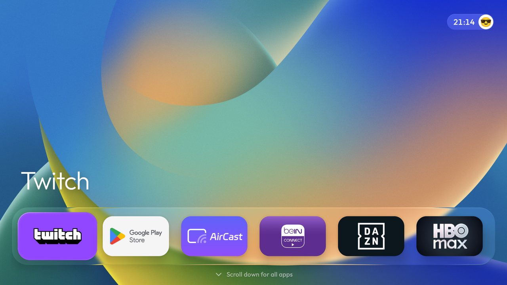
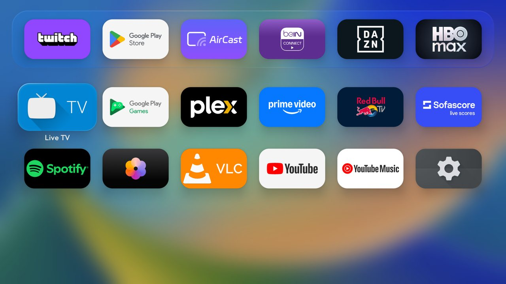
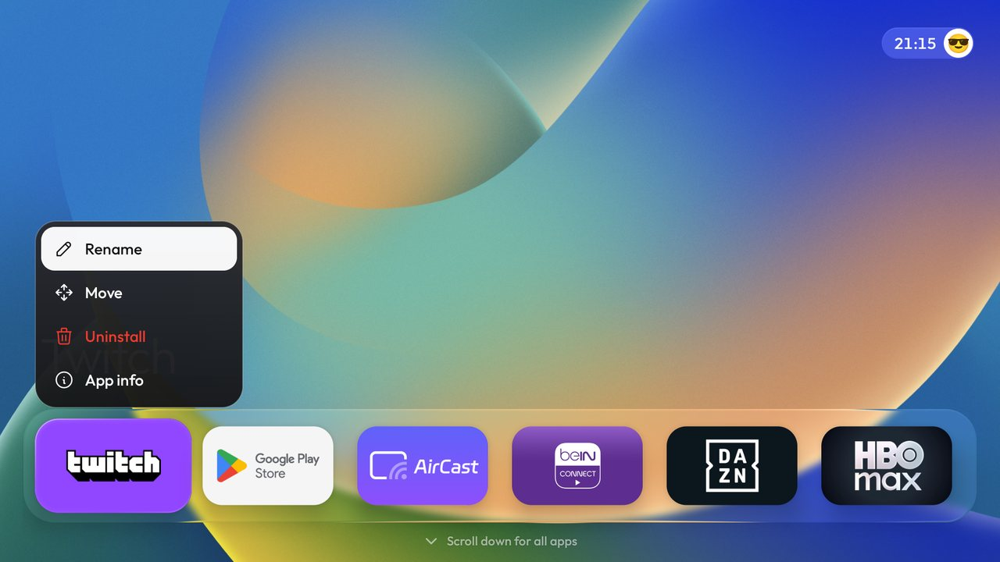
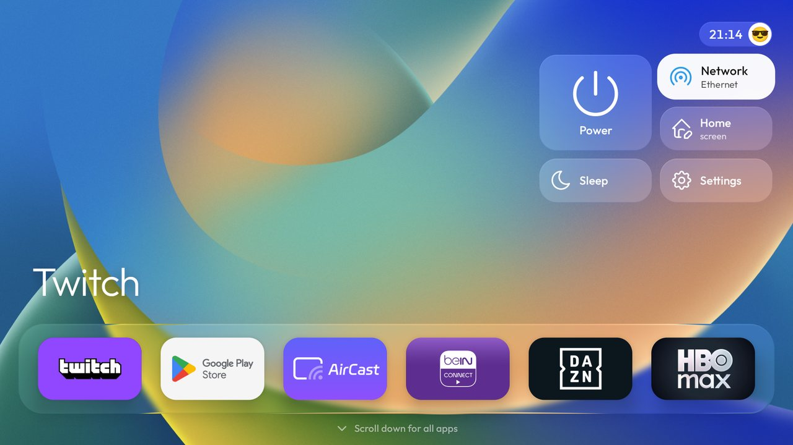
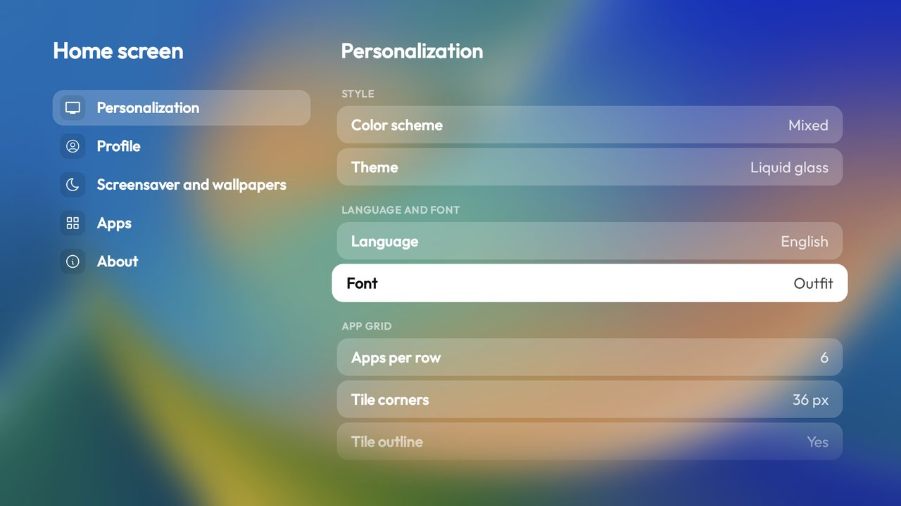
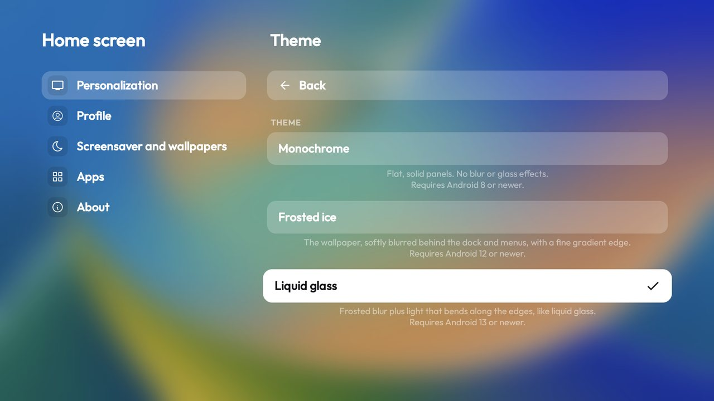
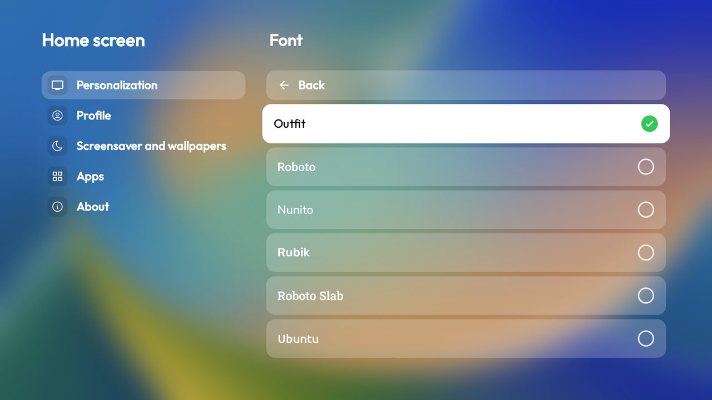

<div align="center">

# LiquidTV

**An Apple&nbsp;TV&ndash;style home screen for Android&nbsp;TV and Google&nbsp;TV.**
A glass dock, a full-screen apps grid, live wallpapers and 14 languages. No ads, no accounts.

[](launcher/app/build.gradle)
[](#requirements)
[](#languages)
[](LICENSE)

**English** · [Русский](README.ru.md)



</div>

---

## Why LiquidTV

Stock TV launchers are crowded with recommendations and ads. LiquidTV replaces them with one calm row of the apps
you actually use, and everything else is one press of **Down** away. It is a plain Java launcher with no ads, no
account and no tracking, and it runs on small TVs.

> LiquidTV is built on [CleanYourTV](https://github.com/Gathin23/cleanyourtv) by Gathin (MIT). The debloat lists
> and tools from that project are still in this repository.

## Features

- **Glass dock.** Your apps on one row over a blurred wallpaper. Three looks: *Monochrome*, *Frosted ice* and *Liquid glass*.
- **All apps, tvOS style.** Press **Down** on the dock and the full apps grid slides up over a blurred wallpaper.
- **Apps open from their tile.** The app window grows out of the tile and fills the screen.
- **Tile menu.** Hold **OK** on an app: *Rename*, *Move*, *Uninstall* (red) and *App info*, each with an icon. The same menu works in the apps grid, plus *Hide*.
- **Light, Dark or Mixed.** Pick the colour scheme for the whole launcher, or for the menu, dock, grid and submenus separately.
- **Wallpapers and screensavers.** Built-in wallpapers, a slideshow, an optional download of more, Apple&nbsp;TV-style live wallpapers and a clock screensaver with a sleep timer.
- **14 languages**, chosen inside the launcher and independent of the system language.
- **6 bundled fonts.** Outfit, Roboto, Nunito, Rubik, Roboto Slab and Ubuntu. They are inside the app, so they are there on any Android build.
- **Quick panel.** Power, network, launcher settings, screensaver and system settings, in one popup from the clock.
- **Profile.** Your name and an emoji avatar on the home screen.
- **Backup and restore** of all launcher settings.
- **Hints only when needed.** The "Scroll down for all apps" line appears only if there are more apps than the dock holds.

## Screenshots

<table>
  <tr>
    <td width="50%"><br><sub><b>All apps.</b> Slides up from the dock over a blurred wallpaper.</sub></td>
    <td width="50%"><br><sub><b>Tile menu.</b> Hold OK on an app.</sub></td>
  </tr>
  <tr>
    <td width="50%"><br><sub><b>Quick panel.</b> Power, network, settings and more.</sub></td>
    <td width="50%"><br><sub><b>Settings.</b> Style, language and font, app grid, appearance.</sub></td>
  </tr>
  <tr>
    <td width="50%"><br><sub><b>Themes.</b> Monochrome, Frosted ice, Liquid glass.</sub></td>
    <td width="50%"><br><sub><b>Fonts.</b> Each name is drawn in its own typeface.</sub></td>
  </tr>
</table>

## Requirements

| | |
|---|---|
| Android | 8.0 (API 26) or newer. Frosted ice needs Android 12+, Liquid glass needs Android 13+. |
| Device | Android TV or Google TV, with a D-pad remote. |
| Tested on | Google TV Streamer (Android 14), Android TV emulators with Android 11 and 14. |

## Install

LiquidTV is built from source. You need JDK 17 and the Android SDK (platform 34, build-tools 34.0.0).

```bash
git clone https://github.com/KirillCh143/LiquidTV.git
cd LiquidTV/launcher
./gradlew assembleRelease          # APK: app/build/outputs/apk/release/app-release.apk
```

Install it over ADB, then make it your home screen:

```bash
adb connect 192.168.1.50:5555      # your TV's address
adb install -r app/build/outputs/apk/release/app-release.apk
```

Then open the quick panel, go to **Home screen → About → Default home screen** (or the TV's own Settings → Apps →
Default home) and pick LiquidTV.

> **Google TV note.** The stock Google TV launcher outranks other launchers, so the Home button may still open it.
> The scripts in [`tools/`](tools) can disable the stock launcher the safe way (`pm disable-user`, never an uninstall)
> and restore it later with `tools/restore.sh`. Install and confirm LiquidTV works first, and read
> [`docs/TROUBLESHOOTING.md`](docs/TROUBLESHOOTING.md) before you disable anything.

`launcher/build-and-install.sh` does the build, the install and the Home check in one go, and disables the stock
launcher only after LiquidTV is confirmed as Home:

```bash
TV_HOST=192.168.1.50 ./build-and-install.sh
```

## Using it

| On the remote | What it does |
|---|---|
| **Down** on the dock | Opens the all-apps grid. |
| **Up** from the dock, then **OK** on the clock | Opens the quick panel. |
| Hold **OK** on an app | Opens its menu: Rename, Move, Uninstall, App info. |
| **Back** | Closes a menu or goes back a level. |

Everything else is in the quick panel under **Home screen**: colour scheme, theme, language, font, wallpapers, the
screensaver, hidden apps, backup and reset.

## Languages

English, Русский, Беларуская, Українська, Қазақша, Türkçe, Italiano, Deutsch, Français, Español, Português,
简体中文, 日本語 and 한국어. Pick one in **Personalization → Language and font**. The texts of the less common
screens fall back to English. Corrections are welcome in `launcher/app/src/main/res/values-*/strings.xml`.

## Permissions

The launcher asks only for what its features need: network access for the optional wallpaper download and the live
wallpapers screensaver, `REQUEST_DELETE_PACKAGES` to open the system's uninstall dialog, and the usual wifi and
network state. The full list is in [`AndroidManifest.xml`](launcher/app/src/main/AndroidManifest.xml).

## Fonts and licences

The code is released under the [MIT licence](LICENSE). The bundled fonts keep their own licences:
Outfit, Nunito, Rubik and Roboto are under the SIL Open Font License; Roboto Slab is under the Apache License 2.0;
Ubuntu is under the Ubuntu Font Licence. All come from [Google Fonts](https://fonts.google.com/).
See [`launcher/FONT-LICENSE-OFL.txt`](launcher/FONT-LICENSE-OFL.txt).

## Status

LiquidTV is in **beta**. It runs on a Google TV Streamer, but your TV may behave differently. If something
goes wrong, open an issue with your TV model, Android version and a screenshot.

---

<div align="center"><sub>LiquidTV · version 0.9.4 Beta · made with care for the big screen</sub></div>
