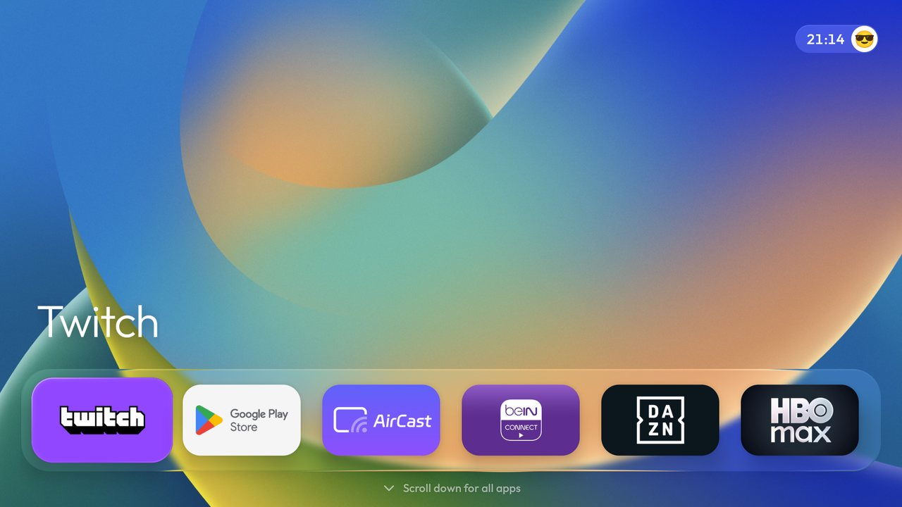
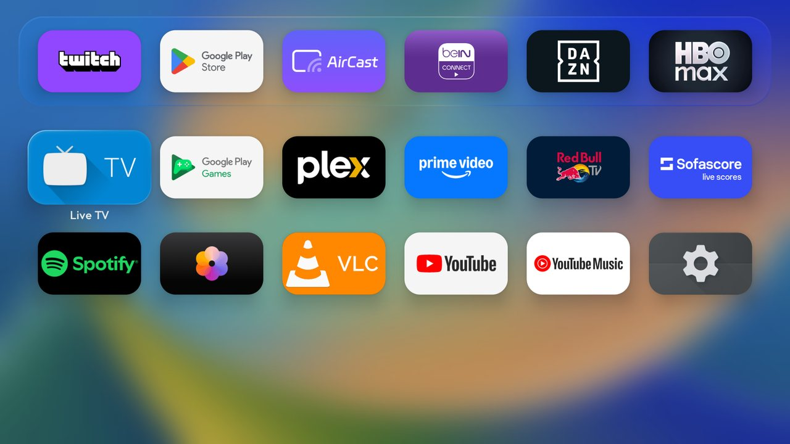
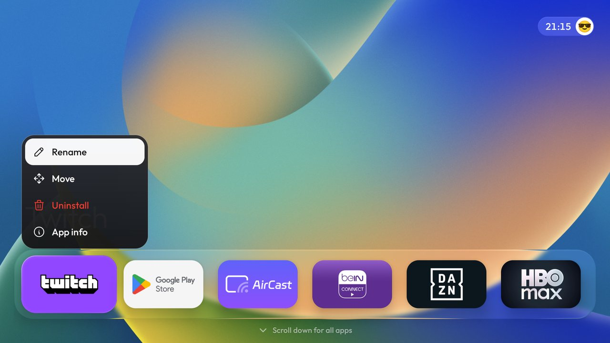
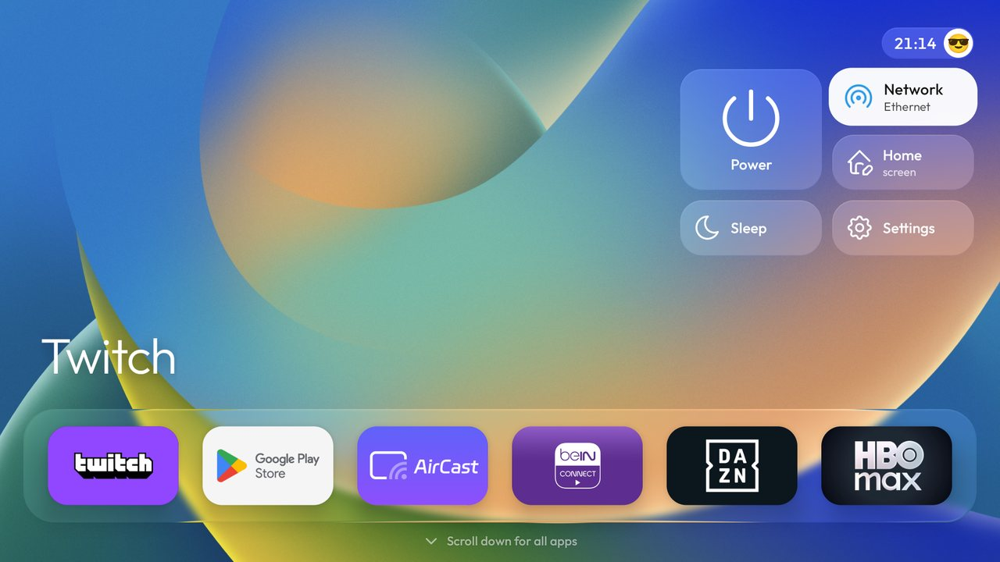
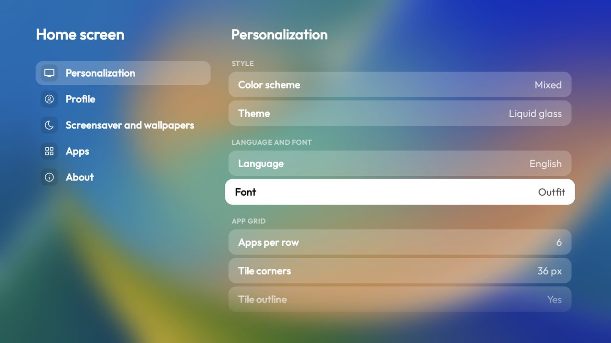
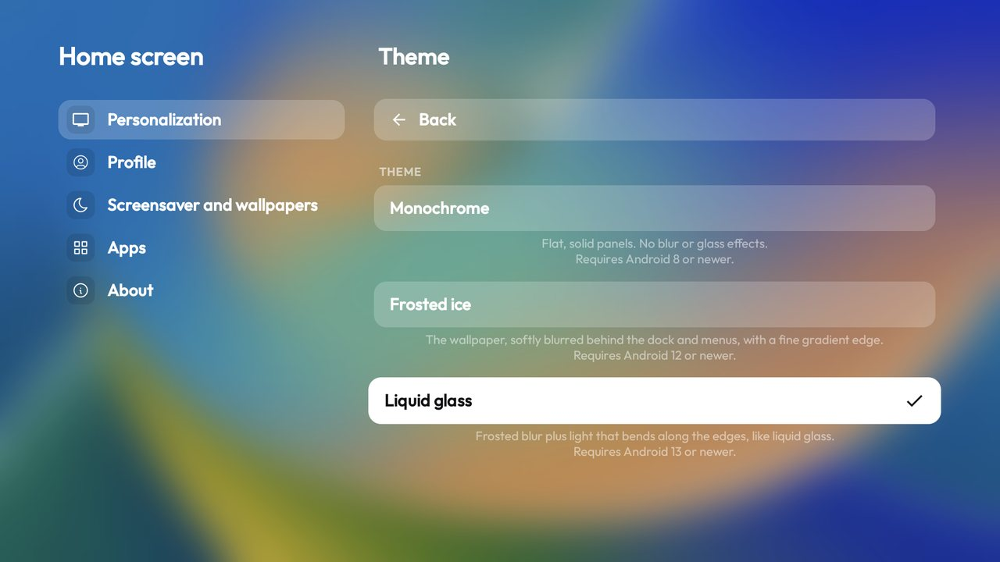
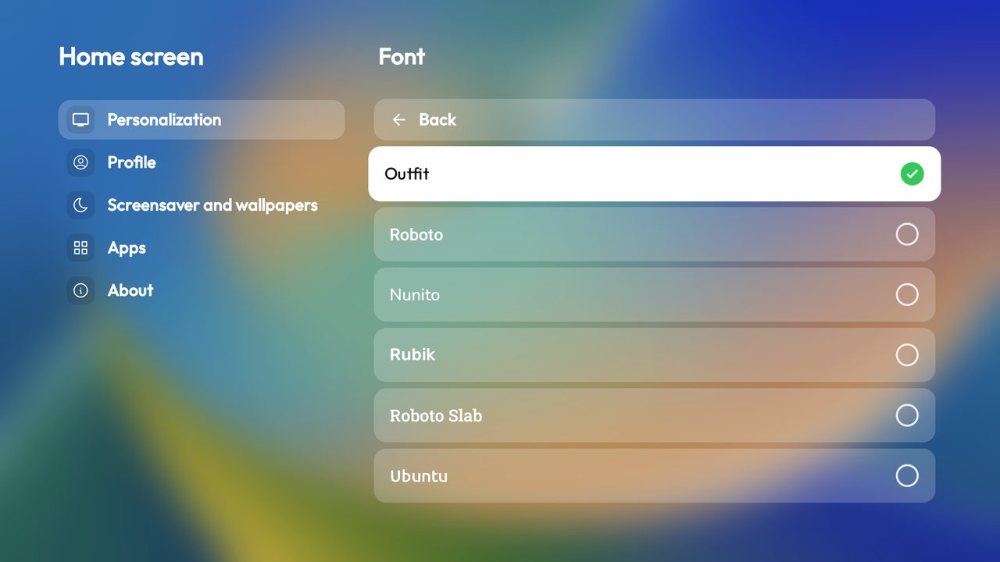

<div align="center">

# LiquidTV

**Домашний экран в стиле Apple&nbsp;TV для Android&nbsp;TV и Google&nbsp;TV.**
Стеклянный док, полноэкранная сетка приложений, живые обои и 14 языков. Без рекламы и аккаунтов.

[](launcher/app/build.gradle)
[](#требования)
[](#языки)
[](LICENSE)

[English](README.md) · **Русский**



</div>

---

## Зачем LiquidTV

Штатные лаунчеры ТВ забиты рекомендациями и рекламой. LiquidTV заменяет их одним спокойным рядом приложений,
которыми вы действительно пользуетесь, а всё остальное открывается одним нажатием **вниз**. Это обычный лаунчер
на Java без рекламы, аккаунтов и слежки, он работает даже на слабых телевизорах.

> LiquidTV построен на [CleanYourTV](https://github.com/Gathin23/cleanyourtv) автора Gathin (MIT). Списки
> отключения лишнего и инструменты из того проекта остались в этом репозитории.

## Возможности

- **Стеклянный док.** Ваши приложения в один ряд поверх размытых обоев. Три вида: *Монохром*, *Матовый лёд* и *Жидкое стекло*.
- **Все приложения в стиле tvOS.** Нажмите **вниз** на доке, и полноэкранная сетка приложений выезжает поверх размытых обоев.
- **Приложения открываются из плитки.** Окно приложения вырастает из плитки на весь экран.
- **Меню плитки.** Удерживайте **OK** на приложении: *Переименовать*, *Переместить*, *Удалить* (красным) и *О приложении*, у каждого пункта своя иконка. То же меню есть в сетке приложений, там добавляется *Скрыть*.
- **Светлая, тёмная или смешанная схема.** Выберите её для всего лаунчера или отдельно для меню, дока, сетки и подменю.
- **Обои и заставки.** Встроенные обои, слайдшоу, необязательная загрузка новых, живые обои в стиле Apple&nbsp;TV и часы-заставка с таймером сна.
- **14 языков**: выбираются внутри лаунчера и не зависят от языка системы.
- **6 встроенных шрифтов.** Outfit, Roboto, Nunito, Rubik, Roboto Slab и Ubuntu. Они лежат в самом приложении, поэтому есть в любой сборке Android.
- **Быстрая панель.** Питание, сеть, настройки лаунчера, заставка и системные настройки в одном всплывающем окне у часов.
- **Профиль.** Ваше имя и эмодзи-аватар на главном экране.
- **Резервная копия и восстановление** всех настроек лаунчера.
- **Подсказки только когда нужны.** Надпись «Прокрутите вниз для всех приложений» появляется, только если приложений больше, чем помещается в док.

## Скриншоты

<table>
  <tr>
    <td width="50%"><br><sub><b>Все приложения.</b> Выезжают из дока поверх размытых обоев.</sub></td>
    <td width="50%"><br><sub><b>Меню плитки.</b> Удерживайте OK на приложении.</sub></td>
  </tr>
  <tr>
    <td width="50%"><br><sub><b>Быстрая панель.</b> Питание, сеть, настройки и не только.</sub></td>
    <td width="50%"><br><sub><b>Настройки.</b> Стиль, язык и шрифт, сетка приложений, внешний вид.</sub></td>
  </tr>
  <tr>
    <td width="50%"><br><sub><b>Темы.</b> Монохром, Матовый лёд, Жидкое стекло.</sub></td>
    <td width="50%"><br><sub><b>Шрифты.</b> Каждое название нарисовано своим шрифтом.</sub></td>
  </tr>
</table>

> На скриншотах интерфейс на английском, но все экраны переведены на 14 языков, см. [Языки](#языки).

## Требования

| | |
|---|---|
| Android | 8.0 (API 26) или новее. Для «Матового льда» нужен Android 12+, для «Жидкого стекла» Android 13+. |
| Устройство | Android TV или Google TV с пультом, у которого есть D-pad. |
| Проверено на | Google TV Streamer (Android 14), эмуляторы Android TV с Android 11 и 14. |

## Установка

LiquidTV собирается из исходников. Нужны JDK 17 и Android SDK (platform 34, build-tools 34.0.0).

```bash
git clone https://github.com/KirillCh143/LiquidTV.git
cd LiquidTV/launcher
./gradlew assembleRelease          # APK: app/build/outputs/apk/release/app-release.apk
```

Установите его по ADB и назначьте главным экраном:

```bash
adb connect 192.168.1.50:5555      # адрес вашего ТВ
adb install -r app/build/outputs/apk/release/app-release.apk
```

Затем откройте быструю панель, зайдите в **Главный экран → О приложении → Главный экран по умолчанию** (или в
системные «Настройки → Приложения → Главный экран по умолчанию») и выберите LiquidTV.

> **Google TV.** У штатного лаунчера Google TV приоритет выше, чем у остальных, поэтому кнопка Home может по-прежнему
> открывать его. Скрипты в [`tools/`](tools) умеют безопасно отключать штатный лаунчер (`pm disable-user`, никогда
> не удаление) и возвращать его через `tools/restore.sh`. Сначала установите LiquidTV и убедитесь, что он работает,
> и прочитайте [`docs/TROUBLESHOOTING.md`](docs/TROUBLESHOOTING.md), прежде чем что-то отключать.

`launcher/build-and-install.sh` делает сборку, установку и проверку Home за один раз и отключает штатный лаунчер
только после того, как LiquidTV подтверждённо стал Home:

```bash
TV_HOST=192.168.1.50 ./build-and-install.sh
```

## Как пользоваться

| На пульте | Что происходит |
|---|---|
| **Вниз** на доке | Открывается сетка всех приложений. |
| **Вверх** с дока, затем **OK** на часах | Открывается быстрая панель. |
| Удерживать **OK** на приложении | Меню приложения: переименовать, переместить, удалить, о приложении. |
| **Назад** | Закрывает меню или возвращает на уровень выше. |

Всё остальное находится в быстрой панели в разделе **Главный экран**: цветовая схема, тема, язык, шрифт, обои,
заставка, скрытые приложения, резервная копия и сброс.

## Языки

English, Русский, Беларуская, Українська, Қазақша, Türkçe, Italiano, Deutsch, Français, Español, Português,
简体中文, 日本語 и 한국어. Выбор находится в **Персонализация → Язык и шрифт**. Тексты редких экранов остаются на
английском. Правки переводов приветствуются в `launcher/app/src/main/res/values-*/strings.xml`.

## Разрешения

Лаунчер запрашивает только то, что нужно его функциям: доступ к сети для необязательной загрузки обоев и заставки
с живыми обоями, `REQUEST_DELETE_PACKAGES`, чтобы открыть системное окно удаления, и обычные состояния Wi-Fi и сети.
Полный список в [`AndroidManifest.xml`](launcher/app/src/main/AndroidManifest.xml).

## Шрифты и лицензии

Код распространяется по [лицензии MIT](LICENSE). У встроенных шрифтов свои лицензии:
Outfit, Nunito, Rubik и Roboto под SIL Open Font License, Roboto Slab под Apache License 2.0, Ubuntu под
Ubuntu Font Licence. Все взяты из [Google Fonts](https://fonts.google.com/).
См. [`launcher/FONT-LICENSE-OFL.txt`](launcher/FONT-LICENSE-OFL.txt).

## Статус

LiquidTV находится в **бета-версии**. Он работает на Google TV Streamer, но на вашем ТВ всё может быть иначе. Если
что-то пошло не так, создайте issue: укажите модель ТВ, версию Android и приложите скриншот.

---

<div align="center"><sub>LiquidTV · версия 0.9.4 Beta · сделано с заботой о большом экране</sub></div>
